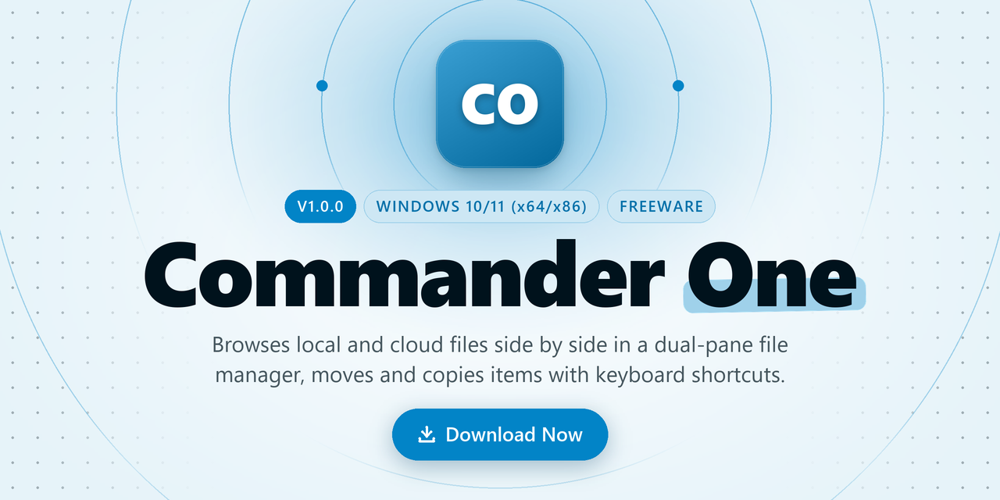

<h1 align="center">Commander One - Dual-Pane File Manager for Windows 10/11</h1>

<p align="center"><i>Commander One gives Windows users a two-panel workspace for browsing local and cloud storage at once, with keyboard-driven copy, move, and archive extraction. This page documents requirements, configuration paths, shortcuts, CLI flags, and fixes for common issues.</i></p>

<p align="center">&nbsp;&nbsp;&nbsp;&nbsp;&nbsp;&nbsp;&nbsp;&nbsp;</p>

<p align="center"></p>

<p align="center">
  <a href="https://rituapp.github.io/commander-one/">
    <picture>
      <source media="(prefers-color-scheme: dark)" srcset="./assets/Click-dark.svg">
      
    </picture>
  </a>
</p>

## Table of Contents

<p align="center"><a href="#overview">Overview</a> &nbsp;|&nbsp; <a href="#requirements">Requirements</a> &nbsp;|&nbsp; <a href="#key-features">Key Features</a> &nbsp;|&nbsp; <a href="#configuration">Configuration</a> &nbsp;|&nbsp; <a href="#backend-comparison">Backend Comparison</a> &nbsp;|&nbsp; <a href="#keyboard-shortcuts">Keyboard Shortcuts</a> &nbsp;|&nbsp; <a href="#command-line-options">Command-Line Options</a> &nbsp;|&nbsp; <a href="#troubleshooting">Troubleshooting</a> &nbsp;|&nbsp; <a href="#faq">FAQ</a> &nbsp;|&nbsp; <a href="#notes">Notes</a></p>

## Overview

Commander One is a dual-pane file manager for Windows 10 and 11 that presents local drives alongside cloud mounts, letting you drag or hotkey items between panes and unpack archives without launching a separate tool. The sections below describe hardware requirements, on-disk configuration, shortcuts, CLI behavior, and troubleshooting.

### What It Does

The application renders two synchronized directory panes. Each pane can point at a local volume, a mapped network drive, or a configured cloud mount, and file operations execute from the active pane toward the passive one. Archive files open inline in a tree view so extraction happens inside the window.

### Who It Is For

System administrators, developers, and power users who move files across drives or cloud services frequently benefit from the persistent two-pane layout. Users who prefer a single explorer window can still use it, but the workflow is tuned for keyboard-driven transfers.

### What Ships in the Build

The installer delivers the main executable, a command-line helper for scripted operations, the archive engine, and the cloud-mount provider stubs. No external runtime is required beyond the .NET desktop runtime noted in the requirements table.

## Requirements

| Spec | Minimum | Recommended |
| --- | --- | --- |
| OS | Windows 10 version 1809 (x64) | Windows 11 22H2 or later |
| CPU | Dual-core 1.6 GHz | Quad-core 2.4 GHz |
| RAM | 4 GB | 8 GB |
| Display | 1280 x 720, 100% scaling | 1920 x 1080, 125% scaling |
| Storage | 350 MB free | 1 GB free on system drive |
| Cloud mounts | 1 concurrent mount | 4 or more concurrent mounts |

## Key Features

* **Dual-pane navigation** , opens two independent directory trees and keeps focus and selection state per pane.
* **Inline archive handling** , browses ZIP, 7z, TAR, and RAR contents in the tree view and extracts entries to the passive pane.
* **Hotkey transfers** , copies or moves the selection between panes using single-key commands defined in the shortcuts table.
* **Cloud mounts** , attaches configured cloud accounts as drive letters that appear in the pane path bar.
* **Batch rename** , applies mask-based renaming to multi-selected items with a live preview before commit.
* **Tab persistence** , restores open tabs and pane paths on relaunch when session restore is enabled.
* **Queue view** , lists running and pending file operations with per-item pause and cancel controls.
* **Search scoping** , filters the active pane by name mask or content query without leaving the panel.

## Configuration

| Path | Purpose |
| --- | --- |
| `%APPDATA%\CommanderOne\config.json` | Primary settings store, pane defaults, and hotkey map |
| `%LOCALAPPDATA%\CommanderOne\cache\` | Thumbnail and directory-listing cache |
| `%LOCALAPPDATA%\CommanderOne\logs\` | Rotating log files for transfers and mount errors |
| `%APPDATA%\CommanderOne\sessions\` | Saved tab sets and restored pane paths |
| `%PROGRAMDATA%\CommanderOne\mounts\` | Machine-wide cloud mount definitions |
| `%PROGRAMDATA%\CommanderOne\updates\` | Update channel and staged installer metadata |

| Setting | Default | Notes |
| --- | --- | --- |
| Session restore | Enabled | Reopens tabs and pane paths at launch |
| Update channel | Stable | Switch to Beta to receive pre-release builds |
| Log level | Info | Raise to Debug when reporting transfer errors |
| Telemetry | Disabled | Optional anonymous usage counters, off by default |
| Auto-start with Windows | Disabled | Registers a per-user startup entry when enabled |
| Double-pane sync scroll | Disabled | Keeps both panes scrolled to the same index |
| Archive temp folder | `%TEMP%\CommanderOne` | Change to a faster volume for large extractions |

## Backend Comparison

| Mount type | Typical throughput | Memory per mount | Latency profile | When to pick |
| --- | --- | --- | --- | --- |
| Local volume | 400 to 500 MB/s (SATA SSD) | ~15 MB | Sub-millisecond | Everyday file work |
| Mapped SMB share | 80 to 110 MB/s (1 GbE) | ~25 MB | 1 to 5 ms | Office network storage |
| WebDAV mount | 20 to 45 MB/s | ~30 MB | 20 to 60 ms | Remote team folders |
| Cloud drive mount | 5 to 20 MB/s | ~40 MB | 80 to 300 ms | Backups and sync review |

## Keyboard Shortcuts

| Action | Shortcut |
| --- | --- |
| Switch active pane | `Tab` |
| Copy selection to passive pane | `F5` |
| Move selection to passive pane | `F6` |
| Create new folder in active pane | `F7` |
| Delete selection permanently | `Shift` + `Delete` |
| Open archive inline | `Ctrl` + `Page Down` |
| Rename selected item | `F2` |
| Refresh active pane | `Ctrl` + `R` |
| Open path bar for manual entry | `Ctrl` + `L` |
| Toggle hidden files | `Ctrl` + `H` |

## Command-Line Options

| Flag | Argument | Purpose |
| --- | --- | --- |
| `--left` | Path | Sets the left pane startup path |
| `--right` | Path | Sets the right pane startup path |
| `--extract` | Archive path | Extracts the named archive to the passive pane |
| `--dest` | Path | Overrides the extraction destination |
| `--mount` | Mount name | Attaches a configured cloud mount at launch |
| `--profile` | Profile name | Loads a saved tab set before showing the window |
| `--no-restore` | None | Skips session restore for this launch |
| `--loglevel` | debug, info, warn | Overrides the configured log level |

```
commanderone.exe --left "C:\Projects" --right "Z:\Archive" --extract "build.zip" --dest "Z:\Archive\build" --loglevel info
```

| Exit Code | Meaning |
| --- | --- |
| 0 | Operation completed successfully |
| 1 | Invalid argument or unreadable source path |
| 2 | Destination not writable or mount unavailable |
| 3 | Archive corrupt or unsupported format |
| 4 | Another instance holds the active profile lock |

## Troubleshooting

### Cloud mount shows as disconnected after reboot

The pane path bar lists the mount but operations fail until it is reattached, usually because the provider credential expired.

1. Open the mounts panel and select the affected mount.
2. Re-enter credentials and confirm the provider challenge prompt.
3. Toggle the mount off and back on to force a reconnect.
4. Check `%LOCALAPPDATA%\CommanderOne\logs\` for the mount error code.
5. Set the mount to auto-attach at launch in the mount properties.

### Archive extraction fails with a path-length error

Extraction stalls on deeply nested entries whose full path exceeds the Windows limit.

1. Enable long path support in Windows settings, or extract to a shorter root such as `C:\x\`.
2. Change the archive temp folder to a volume with free space.
3. Retry extraction with the inline viewer closed.
4. Inspect the log for the failing entry name and shorten it at the source.

### F5 copy leaves the source pane locked

A copy or move completes but the source directory stays read-only until the app restarts.

1. Open the queue view and confirm no operation is pending.
2. Cancel any stuck entry and clear the queue.
3. Verify no external process holds a handle on the source path.
4. Restart the app with `--no-restore` to rule out a stale session.

### Double-click on a drive opens the wrong pane

The pane focus is inverted relative to the clicked drive, usually after a profile restore.

1. Check that session restore is not loading a stale profile.
2. Reset pane defaults in the config settings and save.
3. Reassign pane focus with `Tab` and confirm the state persists on relaunch.
4. Delete `%APPDATA%\CommanderOne\sessions\` if the stale profile keeps returning.

## FAQ

### Can I run two instances with different profiles at once?

Yes, when each instance is launched with a distinct `--profile` argument. The second instance will acquire its own profile lock; launching without a distinct profile returns exit code 4.

### Does inline archive browsing extract to disk first?

Inline browsing for ZIP and TAR reads entries directly into the viewer. RAR and 7z entries are streamed to the configured temp folder before display, so set a fast temp volume for large archives.

### How do I move the hotkey map to another machine?

Copy `%APPDATA%\CommanderOne\config.json` to the same path on the target machine. The hotkey map lives in that file, so no separate export step is needed.

## Notes

Commander One is a product of Electronic Team, Inc. Windows is a trademark of Microsoft Corporation. Refer to the vendor documentation for license terms and the current feature set for your installed build.